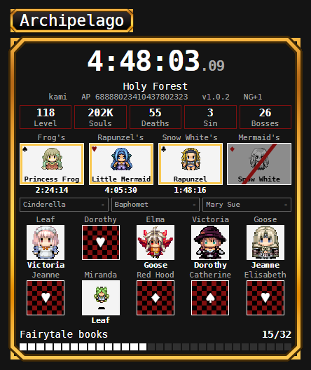

# Black Souls Archipelago

An [Archipelago](https://archipelago.gg) world for BLACK SOULS (RPG Maker VX Ace).

- Pickups and boss rewards are shuffled into the multiworld, including the prologue
- Every boss kill is a check (56 bosses)
- Optional boss shuffle with HP and damage scaled to the arena
- Pick which ending counts as your goal (any ending, or A, B, C or D)
- Optional enemy shuffle

Much of the code is borrowed from or built on my standalone [BLACK SOULS Randomizer](https://github.com/kamin1ii/BlackSoulsRandomizer). The boss, enemy, princess and companion shuffles all run on its engine.

No game files are included. The client patches a copy of your own install.

## Playing

1. Install [Archipelago](https://github.com/ArchipelagoMW/Archipelago/releases) 0.6.2 or newer
2. Download `blacksouls.apworld` from [Releases](../../releases) and double click it
3. Open the Archipelago Launcher and start **Black Souls Client**
4. Type `/install <path to your BLACK SOULS folder>` in the client
5. Connect to the server and play `Game.exe` from the new `BLACK SOULS Archipelago` folder

Or skip the client while playing. `/install` also sets up `Game_Archipelago.exe`, which connects to the server by itself using the address in `archipelago.json` (the client fills it in the first time you connect it).

## Checks

| | Pickups | Boss kills | Total |
|---|---|---|---|
| Default | 571 | 56 | 627 |
| Default with the Ending C goal | 604 | 56 | 660 |
| Unique Checks Only | 87 | 56 | 143 |
| Unique Checks Only with the Ending C goal | 101 | 56 | 157 |

Every boss kill is a check in every mode, the fairytale bosses included. With other goals a fairytale boss still drops its book as a normal reward on top of the check. Ending C puts the 32 fairytale books into the multiworld instead, so the bosses stop dropping them and the 33 other places that hand out a book (NPCs and story events, some books have more than one depending on your choices) become checks. Nearly all of those depend on story choices, so they only hold filler. Unique Checks Only makes one check per unique item (weapons, rings, spells, key items and books), every consumable spot gives its normal item. Skip Kun-Yan, Skip Lost Empire and Skip Atlantica take those areas out on top of this.

## Logic

- The Invitation to Atlantica opens Atlantica, it is the only item that locks off an area
- The Lost Empire, Little Match Girl, the Demonbeast Hero and the Lord of Corruption only appear once all four princess rooms are cleared, so they wait for the Invitation
- The Tainted Bog opens once Fort Ivern is reached, like the normal game
- Ending C needs Fairytale Books Needed of the 32 books, all of them are in the multiworld
- Checks you can miss only hold filler. That is every NPC reward behind a story choice, Lamia, and Dorothy's three targets unless Dorothy's Targets in Logic is on (then they wait for all four princess rooms, so new game plus through Cinderella can always bring her back)
- Elisabeth, Jeanne, the Golden Goose, Marianna, the Crestfallen Hero and the Talking Flower send their boss check however they die
- On a new game plus lap, pickups you already sent stay taken
- Levels and stats are not tracked, for example becoming Dorothy's apprentice needs a stat of 30

The game page in Archipelago ([worlds/blacksouls/docs/en_Black Souls.md](worlds/blacksouls/docs/en_Black%20Souls.md)) has the full details of every option.

## Quality of life

`/install` also brings over these from the standalone randomizer.

- Xbox controller support in `Game.exe`, A confirms, B cancels, X runs and Start opens the menu
- A resizable `Game.exe` window, drag the edges or press F6 to step through sizes
- A stream overlay. Add `BLACK SOULS Archipelago/Randomizer/overlay/run_panel.html` to OBS as a browser source with Local file ticked, 504 tall and about 420 wide. It shows the in-game timer, the area, your level, souls, deaths, sin and bosses beaten, then fills in the princess rooms, companions and fairytale books as you find them

## Tracker

`blacksouls_tracker.zip` in Releases is a [PopTracker](https://github.com/black-sliver/PopTracker/releases) pack. Drag it into the PopTracker window, then connect it to the same server as the client. It marks every check as reachable, out of logic or done.

The full guide is in [worlds/blacksouls/docs/setup_en.md](worlds/blacksouls/docs/setup_en.md).

## Repo layout

- `worlds/blacksouls` is the apworld source
- `worlds/blacksouls/game/ap.rb` is the script injected into the game
- `worlds/blacksouls/game/ap_net.rb` is the direct connection used by `Game_Archipelago.exe`
- `worlds/blacksouls/game/rando_*.rb` with the `overlay`, `sharp` and `upscale` folders are the randomizer's engine, controller support, window sizing and overlay, copied over by `tools/sync_rando.py`
- `tools` holds the scripts used to read the game data, build the location tables and build the tracker

## Credits

- The shuffle engine and boss scaling come from [BLACK SOULS Randomizer](https://github.com/kamin1ii/BlackSoulsRandomizer)
- Direct connection uses [RPGMaker VX Ace AP](https://github.com/EggSlashEther/RPGMaker-VX-Ace-AP) and [archipelago_rb](https://github.com/EggSlashEther/archipelago_rb) by EggSlashEther (MIT). `/install` downloads them from the original repo, and their license ships next to the game as `LICENSE RPGMaker-VX-Ace-AP.txt`
- `Game_Archipelago.exe` is [mkxp-z](https://github.com/mkxp-z/mkxp-z) (GPL-2.0), as included in the kit above
- The direct connection idea comes from the Black Souls 2 Archipelago mod by CthulhusShoes
